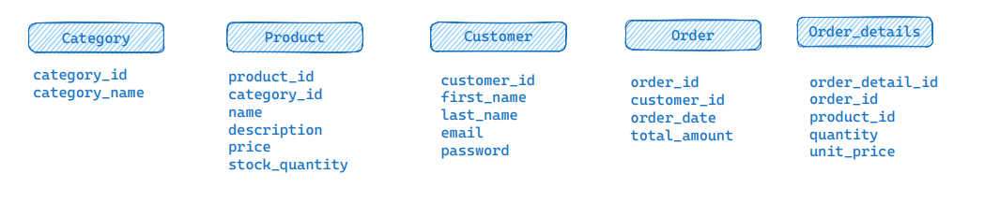
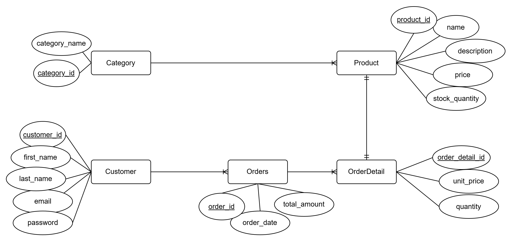

# E-commerce-DB-Design

- we will begin with the following tables at the initial stage of the project:



## Database Script

> refer to the attached SQL script for the creation of the tables.

```sql
CREATE TABLE Category (
  category_id SERIAL PRIMARY KEY,
  category_name VARCHAR(50) NOT NULL
);

CREATE TABLE Product (
  product_id SERIAL PRIMARY KEY,
  category_id INTEGER NOT NULL,
  name VARCHAR(50) NOT NULL,
  description TEXT,
  price NUMERIC (10, 2) NOT NULL, -- up to 99999999.99 (less  10-Million)
  stock_quantity INTEGER NOT NULL,


  FOREIGN KEY (category_id) REFERENCES Category (category_id)
);

CREATE TABLE Customer (
  customer_id SERIAL PRIMARY KEY,
  first_name VARCHAR (100) NOT NULL,
  last_name VARCHAR (100) NOT NULL,
  email VARCHAR(100) NOT NULL UNIQUE,
  password VARCHAR (255) NOT NULL, -- length depend on the hashing algorithm used

  -- depends on business, or regex rules
  CONSTRAINT customer_valid_email CHECK (email like '_%@%_')
);

-- renamed to avoid reserved keyword `Order`
CREATE TABLE Orders (
  order_id BIGSERIAL PRIMARY KEY, -- we expect huge number of orders
  customer_id INTEGER NOT NULL,
  order_date TIMESTAMPTZ NOT NULL DEFAULT NOW(),
  total_amount NUMERIC (12, 2) NOT NULL CHECK (total_amount >= 0),

  FOREIGN KEY (customer_id) REFERENCES Customer (customer_id)
);


CREATE TABLE Order_details (
  order_detail_id BIGSERIAL PRIMARY KEY,
  order_id BIGINT NOT NULL,
  product_id INTEGER NOT NULL,
  quantity SMALLINT NOT NULL CHECK (quantity >= 0),
  unit_price  NUMERIC (10, 2) NOT NULL, -- matches the Product.price
    
  FOREIGN KEY (order_id) REFERENCES Orders (order_id),
  FOREIGN KEY (product_id) REFERENCES Product (product_id)
);

```

## Relationships between tables

- category - product:
  - 1-M (category has many products. each product belongs to a category)

- customer - order:
  - 1-M (customer can place many orders)

- order - orderDetail:
  - 1-M (order has many orderDetails - one per line)

- product - orderDetail:
  - 1-1 (each order detail line refers to a product)

### Notes

- if we want, we may accept NULL values at the Product.category_id column, as the product may not have a category (temporarily).

## ERD diagram



## Sample Queries

> the notation :attribute_name is a placeholder for the actual value of the attribute.

- generate a daily report of the total revenue for a specific date

```sql
SELECT SUM(total_amount) as total_revenue
FROM Orders
WHERE order_date = :date  -- we may use a range query
```

> we may need to truncate the time if needed and use a range query instead of `TRUNC(order_date) = :date` (performace killer)

---

- generate a monthly report of the top-selling products in a given month

```sql
SELECT Product.name as top_selling_product
FROM Order_details JOIN Product
  ON Order_details.product_id = Product.product_id
JOIN Orders
  ON Order_details.order_id = Orders.order_id
WHERE EXTRACT(MONTH FROM Orders.order_date) = :month
GROUP BY Product.product_id
ORDER BY SUM(Order_details.quantity) DESC
LIMIT :limit
```

---

- retrieve a list of customers who have placed orders totaling more than $500 in the past month

- Include customer names and their total order amounts.

```sql
SELECT c.first_name, c.last_name, SUM(o.total_amount) as total_orders_amount
FROM Customer c JOIN Orders o
ON c.customer_id = o.customer_id
-- WHERE o.order_date > NOW() - INTERVAL '1 month'
WHERE o.order_date 
  BETWEEN DATE_TRUNC('month', CURRENT_TIMESTAMP - INTERVAL '1 month') AND DATE_TRUNC('month', CURRENT_TIMESTAMP) -- OR this `where` based on query logic
GROUP BY c.customer_id
HAVING SUM(o.total_amount) > 500
```

---

- Write a SQL query to search for all **products** with the word "camera" in either the product name or description.

> note that using `LIKE` operator is a bad practice as it's a performance killer, and prevent using indexes if any

```sql
SELECT product_id, name, description, price
FROM Product
WHERE name LIKE '%camera%' OR description LIKE '%camera%'
```

- other techniques maybe used as vector search (aka full-text search)
  - may include word trimming, ...etc
  - may build an inverted index to use instead of a full table scan

- maybe postgreSQL is an exception having the GIN index support.

---

- design a query to suggest popular products in the same category for the same author, excluding the Purchsed product from the recommendations?

```java
-- sample code
List<Product> suggestPopularProducts(Long vendorId, Long categoryId, Long productId);
```

```sql
SELECT p.product_id, p.name
FROM Product p JOIN Order_details od ON p.product_id = od.product_id
    JOIN Orders o ON od.order_id = o.order_id
WHERE
    p.vendor_id = :vendor_id                    -- same author
    AND p.category_id = :category_id            -- same category
    AND p.product_id != :product_id             -- exclude the Purchsed product
GROUP BY p.product_id, p.name
HAVING COUNT(od.order_id) >= 1000               -- popular products criteria (sold at least a 1000 times)
ORDER BY COUNT(od.order_id) DESC
```

## Questions

- How we can apply a denormalization mechanism on customer and order entities?

- for `Customer`, we can place the `orders_total_amount` within it, and updated with every order addition/deletion.
  - pros: faster queries, less joins
  - cons: more storage, upating the customer table frequently (may not be costly since it will depend on PK find query)
  - we need to make sure it's immune to race-conditions

- for `Orders`, we can place the customer name in it
  - pros: faster queries, less joins if we want to know the customer name
  - cons: more storage, maintainability (if the customer changed his name, this will lead to a lot of updates)
  - can name updates lead to write amplification?
